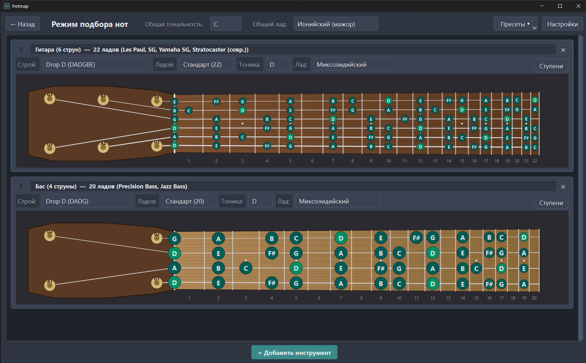

# fretmap

Интерактивная карта нот на грифе. Настраиваете инструмент, строй, тональность
и лад - видите все ноты гаммы на грифе или клавиатуре. Всё работает локально,
без интернета и без веб-сайтов с рекламой.



## Возможности

- **Гитара, бас, пианино, синтезатор** - с реальными пресетами для вашей игры
  (Standard E, Drop D, D Standard, DADGAD, Open G, BEADGBE, EADG, BEADG и др.)
- **Тринадцать ладов** - греческие, пентатоники, блюзовые, гармонический
  и мелодический минор
- **Реалистичный гриф** - с головой (не слишком красивой), колками (не слишком прямыми), деревянной накладкой (из опилок), ладами,
  маркерами на 3, 5, 7, 9, 12
- **Клавиатура** - одна октава или полный диапазон инструмента
- **Ноты или ступени** - подписи в кружках переключаются одним кликом
- **Несколько инструментов одновременно** - например, гитара + бас
  в одном строю, для совместной работы
- **Пресеты** - встроенные пары «гитара + бас» в ходовых строях
  и сохранение своих наборов
- **Тёмные и светлые темы** - Nord, Graphite, Wine, Solarized Dark, Light
- **Настройка цветов** - акцент интерфейса, цвет нот, цвет тоники
- **Drag & drop** - карточки инструментов перетаскиваются за ручку
- **Экспорт** - размер шрифта и размер кружков настраиваются

## Установка

Требуется **Python 3.10+**.

```bash
git clone https://github.com/<ваш-ник>/fretmap.git
cd fretmap
python -m venv .venv
.venv\Scripts\Activate.ps1     # Windows
# source .venv/bin/activate    # Linux / macOS
pip install -e ".[dev]"
python -m fretmap
```

## Как пользоваться

- Запустите приложение. Откроется меню с двумя режимами.
- Выберите «Режим подбора нот».
- Нажмите «+ Добавить инструмент» внизу - выберите инструмент, строй, количество ладов, тонику и лад.
- Настройте параметры прямо в карточке - гриф обновится мгновенно.
- Верхняя панель меняет тонику и лад сразу у всех карточек.
- Пресеты - готовые наборы (гитара + бас в Drop D и т.д.) или сохранение своего набора инструментов и их настроек.

## Форматы и модели

| Инструмент     | Стандартные лады | Модели                                            |
| -------------- | ---------------- | ------------------------------------------------- |
| Гитара 6 струн | 21–24            | Stratocaster, Telecaster, Les Paul, SG, Yamaha SG |
| Гитара 7 струн | 22–24            | Ibanez RG, Jackson Soloist                        |
| Бас 4 струны   | 19–22            | Precision Bass, Jazz Bass                         |
| Бас 5 струн    | 20–24            | Ibanez SR, Ibanez Gio                             |
| Пианино        | 88 клавиш        | A0–C8                                             |
| Синтезатор     | 61 клавиша       | C2–C7                                             |

## Строи

**Гитара 6 струн:** Standard E, Standard Eb, Standard D, Drop D, Drop C, DADGAD, Open G, Open D.

**Гитара 7 струн:** Standard B, Drop A.

**Бас 4 струны:** Standard EADG, Drop D, D Standard, Eb Standard.

**Бас 5 струн:** Standard BEADG, Drop A.

## Лады

Ионийский (мажор), дорийский, фригийский, лидийский, миксолидийский,
эолийский (минор), локрийский, мажорная пентатоника, минорная пентатоника,
мажорный блюз, минорный блюз, гармонический минор, мелодический минор.

## Пресеты

Встроенные:

- Гитара + Бас: Стандарт (E)
- Гитара + Бас: Drop D
- Гитара + Бас: D Standard
- Гитара: Open G + Бас: Стандарт
- Гитара: DADGAD + Бас: Drop D

Свои пресеты сохраняются в `%APPDATA%/fretmap/presets/` (Windows),
`~/.local/share/fretmap/presets/` (Linux) или
`~/Library/Application Support/fretmap/presets/` (macOS).

## Сборка в один .exe

```bash
pip install pyinstaller
python -m PyInstaller --onefile --windowed --name fretmap \
    --icon=src/fretmap/ui/icon.ico \
    --add-data "src/fretmap/ui/icon.ico;fretmap/ui" \
    --paths src \
    src/fretmap/__main__.py
```

Результат - dist/fretmap.exe. Обратите внимание: --onefile даёт один
файл, но запускается на 2–5 секунд дольше - PyInstaller распаковывает
содержимое во временную папку при каждом старте.

## Известные ограничения

- Режим музыкальных упражнений - в разработке, пока кнопка в меню отключена.
- Печать и экспорт в PNG - пока нет.
- Аппликатуры аккордов и гаммы на грифе по одной - не показываются, только отдельные ноты.
- Звук - приложение не проигрывает ноты.

## Лицензия

MIT. См. LICENSE

## Благодарности

- PySide6 - интерфейс.
- Nord - цветовая палитра темы по умолчанию.
